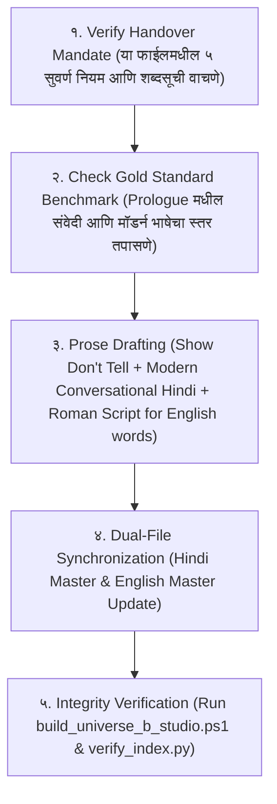

# CANONICAL PROSE STYLE, GOLD STANDARD & WRITER AGENT HANDOVER MANDATE
*(Binding Protocol for Every Scene, Chapter, and Future Writer Agent in Universe B)*

---

## 0. THE UNBREAKABLE HANDOVER MANDATE (लेखक हँडओव्हर नियम)

भविष्यात **कोणताही नवीन Writer Agent, AI मॉडेल किंवा लेखक** या प्रोजेक्टवर काम करायला येईल, तेव्हा त्याने कथेचा एकही शब्द लिहिण्यापूर्वी खालील **५ पायऱ्यांची तपासणी (Mandatory Pre-Flight Check)** करणे बंधनकारक आहे:

---

## 1. THE GOLD STANDARD BENCHMARK (प्रमाणित नमुना)

कथेतील प्रत्येक सीनची संवेदी खोली, लय आणि भाषा खालील प्रमाणित **Modern Cinematic Hinglish Storytelling (VO Formula)** शी १००% जुळली पाहिजे:

> *"सड़ते हुए कचरे की भयानक smell, जले हुए diesel का धुआँ और overflowing gutters की गंदी बदबू... सब कुछ literally सांस लेना मुश्किल कर रहा था। Dadar Station के बाहर पिछले 6 घंटों से non-stop बारिश हो रही थी। पूरी सड़क करीब 2 feet तक गंदे पानी में डूबी हुई थी। पानी में गाड़ियों का oil और grease, जगह-जगह पड़ा plastic waste और सड़ी हुई सब्जियाँ तैर रही थीं। हालत इतनी खराब थी कि गाड़ियों के silencers तक पानी में डूब चुके थे। वहीं दूसरी तरफ, इस भयंकर traffic jam में फंसे trucks के लगातार बजते air horns पूरे माहौल को और भी chaotic बना रहे थे। ऐसा लग रहा था जैसे कोई सीधे कानों में लोहे के पाइप मार रहा हो।"*

**The Master Formula:**  
`Original Meaning + Natural Hinglish + Visual Details + Emotional Impact + Smooth VO Flow`  
*(वापर: Conversational Language, Visual Storytelling, Emotional Impact, Natural Hinglish, Smooth VO Flow + 7 Writing Techniques)*

---

## 2. THE 5 COMMANDMENTS OF WRITING (लेखनाचे ५ सुवर्ण नियम)

### नियम १: "SHOW, DON'T TELL" (माहिती सांगू नका, थेट अंगावर दाखवा)
* ❌ **Telling (निषिद्ध):** *"नील खूप श्रीमंत होता आणि टोनी स्टार्कसारखा हुशार होता."* (हे बायोडेटा वाचल्यासारखे वाटते).
* ✅ **Showing (अनिवार्य):** *खिशात ₹1,00,000 daily limit चा Centurion Black Card, 3 feet पाण्यात hydro-lock पडलेली customized sports coupe, Germany वरून मागवलेले safe silicon wafers, आणि Dadar मध्ये network गेल्यामुळे ₹15 च्या Vada Pav साठी ₹4 short असणारा हसणारा 19 वर्षीय बिलियनेअर जीनियस दाखवा!*

### नियम १.१: NEEL'S MAVERICK BILLIONAIRE TECH PRODIGY PERSONA
* **Neel चा मूळ स्वभाव:** 19 वर्षांचा Gadora Empire चा इकलौता वारिस (अरबोंची equity, shipping docks आणि patents). Worli Sea Face वरील पेंटहाऊसमध्ये स्वतःची private high-tech lab चालवणारा आणि डोक्यात स्वतः implant केलेली open-source Gemma 4 neural chip (GENI) बाळगणारा ब्रिलियंट टेक जीनियस.
* **कथेतील वापर:** जेव्हा तो संकटात सापडतो, तेव्हा तो लाचार किंवा दीनवाणा होत नाही. तो चेहऱ्यावर बेपरवाह, उपरोधिक हास्य (maverick billionaire swagger) आणतो आणि इंजिनिअरिंग प्रिसिजनने परिस्थितीचे विश्लेषण करतो:
  * *"हजारों करोड़ का empire, pocket में ₹1 Lakh limit वाला Black Card, और मैं एक Vada Pav के लिए ₹4 short हूँ क्योंकि बारिश में इस शहर का server down हो गया। Classic।'"*

### नियम १.२: THE 3 CINEMATIC CRAFT LAWS (संवाद, लढाई आणि जग दाखवण्याचे ३ नियम)
1. **Physical Prop & Micro-Action in Dialogue:** संवाद बोलताना पात्र कधीही पुतळ्यासारखे उभे राहत नाही. पात्राच्या हातात एक वस्तू (Prop) द्या जी त्याच्या मनातील भाव दाखवते (उदा. शकुनिचे हाडाचे फासे, बीट्रिसचा कर्ज-पेन, किchecksचे पितळी हातोडे).
2. **4-Step Pure Steel Combat Sequence:**
   - *Internal Strain First:* जादू बाहेर पडण्यापूर्वी शरीरात काय तुटतंय ते दाखवा (नाड्यांमधील वाफ, फुटलेल्या रक्तवाहिन्या).
   - *The 0.2s Acoustic Drop (The Sing):* बाण सुटण्यापूर्वी ०.२ सेकंद आधी १ लाख लोकांचा आवाज गायब होतो—फक्त काच कापणारी शिट्टी वाजते!
   - *Blood in the Gutter:* बाणाचा मधला हवेतला प्रवास न दाखवता, थेट ढाल वितळून शत्रू भिंतीवर आदळल्याचा थेट आघात दाखवा!
   - *Sentence Geometry:* लढाईच्या वेगाप्रमाणे वाक्यांची लांबी लहान-मोठी करा.
3. **Sensory Worldbuilding Without Exposition:** माहिती न सांगता कृतीतून जग दाखवा (उदा. देवांचा अहंकार दाखवण्यासाठी सोलेरियन उमरावाने रक्ताचा थेंब सौर्य-ठिणगीने भस्म करणे).

### नियम २.१: SIMPLICITY & UNIVERSAL DESCRIPTIVE WORDS (अडखळवणारे शब्द टाळून सोपे वर्णनात्मक शब्द वापरणे)
केवळ शब्दसूचीपुरते मर्यादित न राहता, असा कोणताही शब्द जो सामान्य वाचकाला (General Reader) अडखळवतो किंवा ज्याचा अर्थ पटकन समजत नाही, तो **१००% टाळला पाहिजे**. त्याऐवजी डोळ्यांसमोर थेट चित्र उभे करणारे सोपे, वर्णनात्मक पर्याय वापरा:

* ❌ **चेचक / खुरदुरे गड्ढे** $\rightarrow$ ✅ **गहरे काले दाग** (प्रत्येकाला लगेच कळते).
* ❌ **गाड़ीवान** $\rightarrow$ ✅ **गाड़ी वाला / बौना आदमी** (रोजच्या बोलचालीचा शब्द).
* ❌ **औंधा पड़ा था** $\rightarrow$ ✅ **पेट के बल पड़ा था** (साधा आणि नैसर्गिक).
* ❌ **दारू / गुटखा** $\rightarrow$ ✅ **सड़ी मदिरा और पसीना** (कॅनॉनिकल हाय-फॅन्टसी वातावरण).
* ❌ **कनपटी / जबड़ा / नथुने** $\rightarrow$ ✅ **सिर / मुँह / नाक** (साधे अवयव सोपे ठेवा).

| ❌ BANNED (जुनाट / पुस्तकी शब्द) | ✅ MANDATORY (सोपे / मॉडर्न शब्द) | कारण |
| :--- | :--- | :--- |
| **धँसी** | **कूद पड़ी / जा गिरी / फँसी / गिरी** | बस किंवा वाहनांसाठी जुनाट वाटते; 'कूद पड़ी' जिवंत वाटते. |
| **आस्तीन** | **sleeve / hoodie की sleeve** | १९व्या शतकातील उर्दू शब्द; हुडीसाठी 'sleeve' नैसर्गिक आहे. |
| **महफूज** | **safe / सुरक्षित** | जुनाट औपचारिक शब्द; 'safe' आधुनिक आणि सहज आहे. |
| **बुदबुदाया** | **धीमे से बोला / हँसकर बोला / कहा** | इंग्रजी 'muttered' चे पुस्तकी भाषांतर. |
| **फुसफुसाया** | **धीमी आवाज में कहा / धीमे से बोला** | विक्टोरियन नाटकासारखे वाटते. |
| **कौंध गए** | **आँखों के सामने आ गए / याद आ गए / flash हो गए** | कृत्रिम आणि फिल्मी रूपक. |
| **परंतु / किंतु** | **लेकिन / पर** | पाठ्यपुस्तकी संस्कृत जोडशब्द; बोलण्यात 'लेकिन/पर' वापरा. |
| **भीतर** | **अंदर** | जुनाट भाषेचा शब्द; 'अंदर' नैसर्गिक आहे. |
| **प्राचीर** | **दीवार / बाउंड्री / wall** | उच्च संस्कृत शब्द जो वाचनाचा वेग मंदावतो. |
| **नथुनों** | **नाक** | ९०% वाचक नथुने शब्दात अडखळतात. |
| **हलक / कंठ** | **गला** | गळ्यासाठी 'गला' हाच रोजचा शब्द आहे. |
| **भभका / सड़ांध** | **बदबू / हवा** | सेंद्रिय घाणीसाठी थेट बदबू वापरा. |
| **पित्त** | **acidity / खट्टा पानी** | |
| **कुल जमा** | **total / कुल मिलाकर** | |
| **क्षण** | **second / पल** | |
| **नेत्र / नयन** | **आँखें** | |
| **हस्त / पाद** | **हाथ / पैर** | |
| **नश्वर जिस्म** | **शरीर / बदन** | |
| **कौंध उठी / चीरती हुई** | **चमकी / पार करती हुई** | |
| **मानो** | **[पूर्ण बंदी]** | AI चे ट्रेडमार्क शब्द. थेट वर्णन करा. |
| **एक अजीब-सी** | **[पूर्ण बंदी]** | नेमकी संवेदना लिहा (उदा. बर्फासारखी थंडी). |
| **दहकना / दहक उठी** | **जलने लगी / तपने लगी** | पुस्तकी/काव्यात्मक शब्द; आधुनिक भाषेत 'जलने लगी' वापरा. |
| **वह / यह** (Narration मध्ये) | **वो / ये** | 'वह' जुनाट रेडिओसारखा वाटतो, 'वो' जिवंत वाटतो. |
| **Neel Gadora (वारंवार नाव)** | **Neel (९९.९% वेळेस)** | प्रत्येक वाक्यात आडनाव घेणे बंद करा; तो फक्त 'Neel' आहे! |

### नियम २.२: ZERO TRAILING "A" SANSKRIT ROOT RULE
संस्कृत-उद्भव नावे लिहिताना इंग्रजीत शेवटी विनाकारण `'a'` लावून उच्चार मऊ करू नका:
* ❌ *Arka, Karna, Bhima, Drona, Kansa, Parikshita, Paundraka, Shrutayudha*
* ✅ **Ark (अर्क), Karn (कर्ण), Bheem (भीम), Dron (द्रोण), Kans (कंस), Parikshat (परीक्षित), Paundra (पौण्ड्र), Jaras (जरस)**

### नियम २.३: THE DEVA-VANI TIERED NOMENCLATURE RULE (दैव-वाणी नियम)
* **मूळ तत्त्व:** संस्कृत ही विश्वाची मूळ दैवी भाषा (**Deva-Vani / Para-Vak**) आहे.
* **लो-टायर / सुरुवातीचा स्तर:** Volume 1–2 मधील बफर झोन, डस्ट ट्रेंच आणि सामान्य रस्त्यांवर उच्च संस्कृत संज्ञा थेट न वापरता त्यांची **इंग्रजी / व्यावहारिक रूपे** वापरावीत:
  * **Kshira Sagara** $\rightarrow$ **The Celestial Cataract** *(or The Milky Funnel / Cosmic Sieve)*
  * **Svarga-Loka** $\rightarrow$ **Heaven** *(or The Sky Citadel)*
  * **Patala** $\rightarrow$ **The Cursed Realm** *(or The Core Abyss)*
  * **Chitragupta Archive** $\rightarrow$ **The Sieve Registry / Cosmic Ledger**
  * **Rikta** $\rightarrow$ **Blank / Unindexed / Null** *(e.g., `[STATUS: UNINDEXED / BLANK]`)*
  * **Indra-Upadhi** $\rightarrow$ **The Sovereign / The Gold Chair**
  * **Manu-Upadhi** $\rightarrow$ **The Iron Sovereign / The Central King**
* **उच्च स्तरीय प्रकटीकरण:** जेव्हा Neel चा दर्जा Grade 5 वरून वर चढेल, तेव्हाच उच्च इनक्विझिटर्स आणि ऋषींकडून मूळ **Deva-Vani (संस्कृत)** नावे समोर येतील.

### नियम ३: ROMAN SCRIPT FOR EVERYDAY ENGLISH WORDS
रोजच्या बोलण्यातले इंग्रजी शब्द देवनागरीत न लिहिता **Roman Script** मध्येच लिहा, पण अवयव आणि मूलभूत क्रिया हिंदीत ठेवा:
* ✅ **हे Roman मध्ये लिहा:** `phone`, `battery`, `screen`, `BEST bus`, `hoodie`, `sleeve`, `cashmere`, `sneakers`, `silicon wafers`, `micro-controllers`, `Centurion Black Card`, `sports coupe`, `hydro-lock`, `Vada Pav`, `GENI`, `pass`, `second`, `traffic`, `cart`, `upgrade`, `luck`, `power button`, `safe`, `short`, `rank`, `badge`, `spire`, `dorm`.
* ❌ **अवयवांचे इंग्रजी टाळा (Overuse Ban):** *eyes, head, legs, cheek, drop* नको; *आँखें, सिर, पैर, गाल, गिरा* वापरा.

### नियम ३.१: THE 'नही' CANON LOCK (बिंदी नसलेले 'नही')
लेखकाच्या अनिवार्य नियमानुसार, या संपूर्ण विश्वात 'नहीं' ऐवजी नेहमी **'नही'** (बिंदी/अनुस्वार नसलेले) असेच लिहायचे आहे.

### नियम ४: NUMERICAL DIGITS ONLY (आकडे नेहमी अंकांमध्येच)
* ❌ अक्षरी बंदी: *ग्यारह, पंद्रह, सोलह, बहत्तर हजार, छह, साढ़े सात*
* ✅ अनिवार्य अंक: `11`, `15`, `16`, `72,000`, `6`, `7:30`, `8%`, `0%`, `58`, `100`, `200`, `5,000`

### नियम ५: DUAL-TRACK INDEPENDENT CRAFTING & PROGRESSION LOOP
* **Hindi Master First:** `_Hindi.md` फाईल ही मूळ मास्टर प्रत आहे.
* **English Master Second:** इंग्रजी फाईल ही गुगल ट्रान्सलेशन नसेल; ती ब्रँडन सँडरसन / लॉर्ड ऑफ द मिस्ट्रीजच्या तोडीची स्वतंत्र हाय-फॅन्टसी गद्यशैली असेल.
* **The 5-Stage Progression Pipeline:** कथा एकाच स्टेडियममध्ये बंदिस्त राहणार नाही. ती ५ टप्प्यांत फिरेल:
  1. *Stage 1:* Registration (Contender Slate + Adventurer Guild Tag)
  2. *Stage 2:* Adventurer Guild Quests (रानातली शिकार आणि Beast-Cores)
  3. *Stage 3:* The Clan Sanctum Trials (Pokémon-style ८ Gym Badges / Mudra-Seals)
  4. *Stage 4:* The 4 Regional Sister-Tournaments (१,०००-पॉईंट्स क्वालिफिकेशन)
  5. *Stage 5:* The Central City Proving Games (Live Ranked Classes #५,००० ते #१)

---

## 3. CHECKLIST FOR FUTURE WRITER AGENTS (नवीन एजंटसाठी ७-सूत्री पडताळणी)

कोणताही नवीन सीन सबमिट करण्यापूर्वी एजंटने स्वतःला हे विचारणे बंधनकारक आहे:
1. [ ] मी पात्राची माहिती सांगणारा निबंध लिहिला आहे का, की वाचकाला थंडी, भूक आणि चिखल अंगावर जाणवला?
2. [ ] या मजकुरात 'मानो', 'एक अजीब-सी', 'नथुनों', 'हलक', 'धँसी', 'आस्तीन', 'महफूज' असा एकही जुनाट शब्द चुकून आला आहे का?
3. [ ] सर्व आकडे अंकांमध्ये (`11`, `15`, `72,000`, `200`) आहेत का?
4. [ ] इंग्रजी शब्द Roman script मध्ये (`BEST bus`, `hoodie`, `sleeve`, `phone`, `Black Card`) आहेत का?
5. [ ] 'नही' शब्द १००% बिंदी-मुक्त (dot-free) आहे का? (0 'नहीं')
6. [ ] Neel ला 'Neel Gadora' म्हणून वारंवार संबोधणे टाळले आहे का?
7. [ ] `build_universe_b_studio.ps1` आणि `verify_index.py` चालवून सर्व चाचण्या पास झाल्या आहेत का?

**या नियमांचे तंतोतंत पालन करणे Universe B च्या प्रत्येक लेखकासाठी बंधनकारक आहे.**
