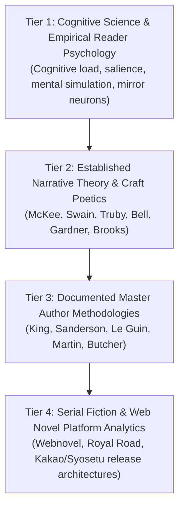

# UNIVERSE B — STORYTELLING RESEARCH ARCHITECTURE & OPERATING SYSTEM
**Document ID:** `UB-RESEARCH-ARCH-00`  
**Workspace:** `D:\Web Novel\UNIVERSE B\Research\Storytelling_System\00_RESEARCH_ARCHITECTURE_AND_METHODOLOGY.md`  
**Status:** [APPROVED ARCHITECTURE SPECIFICATION]  
**Target Output:** Practical Web Novel Writing Operating System (WNW-OS)

---

## 1. Executive Mission & System Objective

This research architecture provides a disciplined, evidence-based, and modular operational framework for authoring *Universe B*. 

The objective is to move beyond abstract literary theory and establish a **usable craft operating system** that addresses the central question:
> **What makes a story compelling, what makes a scene feel alive, and how can these principles be systematically applied to authoring an serialized epic web novel without formulaic decay or canonical drift?**

### The Three Inviolable Operating Principles:
1. **Separation of Craft Research and Narrative Execution:** Craft principles are investigated first as objective, universal literary and psychological mechanisms. Their application to *Universe B* is conducted as a distinct secondary step.
2. **Absolute Canon Protection:** Story facts, metaphysical axioms, character registries, and technological boundaries established in `New/` and `PROJECT_HANDOVER_AND_ARCHITECTURE_MANUAL.md` remain immutable. Prose craft, scene pacing, and sensory staging serve the canon; they never rewrite or alter established facts without explicit user approval.
3. **Tool-First Deliverable Priority:** While comprehensive theoretical documentation is maintained, priority is placed on actionable tools:
   - **Tool 1: Scene Builder Template** (Pre-drafting architecture)
   - **Tool 2: Scene Liveliness Diagnostic** (Post-draft triage for flat/mechanical scenes)
   - **Tool 3: Chapter Builder Protocol** (Serial pacing, hooks, and narrative progression)
   - **Tool 4: Troubleshooting Handbook** (Problem-specific tactical solutions)

---

## 2. Research Methodology & Evidence Tiers

To ensure findings are credible and robust, all investigated principles are classified into four distinct evidentiary tiers:



### Analysis Matrix for Every Principle
Every investigated factor across all modules must answer five mandatory questions:
1. **WHAT it is:** Rigorous definition and conceptual boundaries.
2. **WHY it works:** Psychological and narrative mechanics (why the human brain responds).
3. **WHEN to use it (and when not to):** Contextual indicators, scene goals, and genre constraints.
4. **HOW to implement it:** Concrete sentence-level, beat-level, or scene-level execution tactics.
5. **HOW to identify when it is missing:** Diagnostic symptoms, red flags, and before/after demonstrations.

---

## 3. Modular Investigation Map (Modules A through L)

The investigation is structured into 12 self-contained, progressive research modules:

| Module | Focus Area | Core Investigated Problems | Primary Deliverable Link |
| :--- | :--- | :--- | :--- |
| **Module A** | Foundations of Storytelling | Story vs. Plot vs. Narrative; Causality; Consequence; Information Management; Promises & Payoffs. | Narrative Necessity Framework |
| **Module B** | Scene Construction & Purpose | Swain’s Scene & Sequel; Micro-goals; Conflict; Turning Points; Complications; Scene Boundaries. | Reusable Scene Blueprint (Tool 1) |
| **Module C** | Scene Liveliness & Immersion | Physical Grounding; 5-Sense Selection; Spatial Continuity; Environmental Resistance; Emotional Immediacy. | Liveliness Diagnostic (Tool 2) |
| **Module D** | POV & Narrative Distance | Psychic Distance (Gardner); Viewpoint Leaks; Free Indirect Discourse; Information Restrictions. | POV Audit Framework |
| **Module E** | Character & Emotional Depth | Desire vs. Need; Contradiction; Behavior Under Pressure; Moral Stakes; Relational Friction. | Character Chemistry Matrix |
| **Module F** | Dialogue & Subtext | Speech Patterns; Conversational Objectives; Avoidance & Interruption; Dialogue Beats vs. Tags. | Dialogue Revision Checklist |
| **Module G** | Prose Craft & Sentence Rhythm | Concrete Nouns; Active Verbs; Filter Word Elimination; Cadence Modulation; Visual Density. | Sentence-Level Editing Suite |
| **Module H** | Pacing, Tension & Suspense | Information Withholding; Delayed Resolution; Micro-Tension; Clues vs. Confusion; Scene-End Hooks. | Pacing & Tension Engine |
| **Module I** | Web Novel & Serial Storytelling | Chapter Arc Architecture; Retention Hooks; Mid-Arc Momentum; Exposition Dosing; Fatigue Prevention. | Chapter Builder Protocol (Tool 3) |
| **Module J** | Worldbuilding & Exposition | Iceberg Theory; Experiential Worldbuilding; Contextual Drip-Feeding; System Integrity. | Exposition Dosing Matrix |
| **Module K** | Drafting, Editing & Troubleshooting | Overcoming Drafter’s Paralysis; Multi-Pass Revision Pipeline; Scene Surgery; Consistency Auditing. | Troubleshooting Handbook (Tool 4) |
| **Module L** | Master Author Exegesis | Specific Author Techniques (King, Sanderson, Miura, Isayama, Cuttlefish) Decoupled from Prose Imitation. | Author Craft Deconstruction |

---

## 4. Execution Sequence & Staged Roadmap

To maintain depth and prevent superficial summaries, research will proceed systematically in four phased milestones:

```text
========================================================================================
                          SYSTEM IMPLEMENTATION ROADMAP
========================================================================================

PHASE 1: RESEARCH FOUNDATION & ARCHITECTURE (CURRENT)
├── Deliverable: 00_RESEARCH_ARCHITECTURE_AND_METHODOLOGY.md
└── Deliverable: 01_SOURCE_LIBRARY_AND_CATALOGUE.md

PHASE 2: CORE SCENE & PROSE CRAFT MODULES (MODULES A, B, C, G)
├── Deep Dive into Scene Construction (Swain's MRUs, McKee's Value Shifts)
├── Deep Dive into Scene Liveliness & Physical Grounding (Gardner, Cognitive Salience)
├── Deep Dive into Prose Mechanics (Filter words, Rhythm, Concrete imagery)
└── Deliverable: Tool 1 (Scene Builder) & Tool 2 (Liveliness Diagnostic)

PHASE 3: CHARACTERS, DIALOGUE, POV & PACING (MODULES D, E, F, H)
├── Narrative Distance & Viewpoint Discipline
├── Subtext, Conversational Friction, Character Voice
├── Suspense, Mystery, Information Asymmetry
└── Deliverable: POV Audit & Character Reaction Matrices

PHASE 4: SERIAL SYSTEMS, WORLDBUILDING & TROUBLESHOOTING (MODULES I, J, K, L)
├── Web Novel Serial Pacing & Chapter Mechanics
├── Experiential Worldbuilding & Exposition Control
├── Master Troubleshooting Handbook & 9-Step Revision Pipeline
└── Deliverables: Tool 3 (Chapter Builder) & Tool 4 (Troubleshooting Handbook)
========================================================================================
```

---

## 5. Verification & Canon Protection Protocol

Before any researched principle is adapted into a writing guideline for *Universe B*, it must pass the **Triple Canon Guard Filter**:

1. **The Technology Ceiling Check:** Does this technique inadvertently encourage steampunk/modern concepts (e.g., ticking pocket watches, chemical explosions, mechanical trains)? If yes, adapt strictly to grounded Vedic High-Fantasy equivalents (e.g., acoustic mantra chime, beast-drawn rath, stone gate resonance).
2. **The Metaphysical Grounding Check:** Does the technique assume Western hard-magic mana or gamified blue stat menus? If yes, transpose into *Nadi-Sadhana*, Pranic flow, and *Kruti* crisis awakening.
3. **The Multi-Track Language Check:** Can the resulting scene blueprint translate seamlessly across both the **Canonical English Prose** and the **Official Muse/Crunchyroll-Style Hindi Dub** tracks without losing sensory rhythm or dub cadence?

---
*Universe B Storytelling Research System — Master Architecture Document.*
