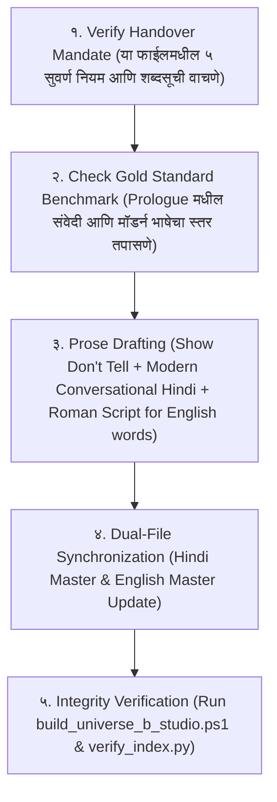

# CANONICAL PROSE STYLE, GOLD STANDARD & WRITER AGENT HANDOVER MANDATE
*(Binding Protocol for Every Scene, Chapter, and Future Writer Agent in Universe B)*

---

## 0. THE UNBREAKABLE HANDOVER MANDATE (लेखक हँडओव्हर नियम)

भविष्यात **कोणताही नवीन Writer Agent, AI मॉडेल किंवा लेखक** या प्रोजेक्टवर काम करायला येईल, तेव्हा त्याने कथेचा एकही शब्द लिहिण्यापूर्वी खालील **३ पायऱ्यांची तपासणी (Mandatory Pre-Flight Check)** करणे बंधनकारक आहे:

---

## 1. THE GOLD STANDARD BENCHMARK (प्रमाणित नमुना)

कथेतील प्रत्येक सीनची संवेदी खोली, लय आणि भाषा खालील प्रमाणित मजकुराशी १००% जुळली पाहिजे:

> *"सड़ते कचरे, गाड़ियों के काले धुएं और गटर की तीखी बदबू सीधे गले में उतर रही थी। दादर स्टेशन के बाहर, 6 घंटे से नॉन-स्टॉप बारिश हो रही थी। सड़कों पर दो फीट तक गंदा, मटमैला पानी भरा था...*
> *Neel ने जेब में हाथ डाला। भीगी उँगलियों ने 10 के मुड़े हुए नोट को छुआ। उसके साथ 1 का एक घिसा हुआ, ठंडा सिक्का फँसा था। टोटल 11 रुपये। 15 का वड़ापाव, और जेब में 11...*
> *कम से कम रूम तक पहुँचने तक इस फोन का जिंदा रहना जरूरी था।"*

---

## 2. THE 5 COMMANDMENTS OF WRITING (लेखनाचे ५ सुवर्ण नियम)

### नियम १: "SHOW, DON'T TELL" (माहिती सांगू नका, थेट अंगावर दाखवा)
* ❌ **Telling (निषिद्ध):** *"नील खूप गरीब आणि उपाशी होता आणि तो १६ व्या वर्षी अनाथ झाला होता."* (हे बायोडेटा वाचल्यासारखे वाटते).
* ✅ **Showing (अनिवार्य):** *१० रुपयांची घामट ओली नोट, १ रुपयाचे गारठलेले नाणे, उपाशी पोटातील ॲसिडिटीची जळजळ, आणि ३ वर्षे एकाही नातेवाईकाचा फोन न आलेली ८% बॅटरीची फुटलेली स्क्रीन दाखवा!*

### नियम १.१: NEEL'S POP-CULTURE NERD PERSONA (MCU, DC & Anime Background)
* **Neel चा मूळ स्वभाव:** तो मुंबईच्या चाळीत वाढलेला असला तरी MCU, DC, कॉमिक्स आणि Isekai Animes चा चाहता आहे.
* **कथेतील वापर:** जेव्हा तो या नव्या जगात येतो, तेव्हा त्याच्या डोक्यात ॲनिमेचे संदर्भ धावतात. तो सिस्टीम मागण्याचा किंवा 'Status Window' उघडण्याचा प्रयत्न करतो, पण वास्तव क्रूर असल्याने काहीच घडत नाही:
  * *"System... Status window open कर! Location info दे... अरे घंटा कुछ नही हुआ!"*

### नियम १.२: THE 3 CINEMATIC CRAFT LAWS (संवाद, लढाई आणि जग दाखवण्याचे ३ नियम)
1. **Physical Prop & Micro-Action in Dialogue:** संवाद बोलताना पात्र कधीही पुतळ्यासारखे उभे राहत नाही. पात्राच्या हातात एक वस्तू (Prop) द्या जी त्याच्या मनातील भाव दाखवते (उदा. शकुनिचे हाडाचे फासे, बीट्रिसचा कर्ज-पेन, किchecksचे पितळी हातोडे).
2. **4-Step Pure Steel Combat Sequence:**
   - *Internal Strain First:* जादू बाहेर पडण्यापूर्वी शरीरात काय तुटतंय ते दाखवा (नाड्यांमधील वाफ, फुटलेल्या रक्तवाहिन्या).
   - *The 0.2s Acoustic Drop (The Sing):* बाण सुटण्यापूर्वी ०.२ सेकंद आधी १ लाख लोकांचा आवाज गायब होतो—फक्त काच कापणारी शिट्टी वाजते!
   - *Blood in the Gutter:* बाणाचा मधला हवेतला प्रवास न दाखवता, थेट ढाल वितळून शत्रू भिंतीवर आदळल्याचा थेट आघात दाखवा!
   - *Sentence Geometry:* लढाईच्या वेगाप्रमाणे वाक्यांची लांबी लहान-मोठी करा.
3. **Sensory Worldbuilding Without Exposition:** माहिती न सांगता कृतीतून जग दाखवा (उदा. देवांचा अहंकार दाखवण्यासाठी सोलेरियन उमरावाने रक्ताचा थेंब सौर्य-ठिणगीने भस्म करणे).

### नियम २.१: SIMPLICITY & UNIVERSAL DESCRIPTIVE WORDS (अडखळवणारे शब्द टाळून सोपे वर्णनात्मक शब्द वापरणे)
केवळ शब्दसूचीपुरते मर्यादित न राहता, असा कोणताही शब्द जो सामान्य वाचकाला (General Reader) अडखळवतो किंवा ज्याचा अर्थ पटकन समजत नाही, तो **१००% टाळला पाहिजे**. त्याऐवजी डोळ्यांसमोर थेट चित्र उभे करणारे सोपे, वर्णनात्मक पर्याय वापरा:

* ❌ **चेचक / खुरदुरे गड्ढे** $\rightarrow$ ✅ **गहरे काले दाग** (प्रत्येकाला लगेच कळते).
* ❌ **गाड़ीवान** $\rightarrow$ ✅ **गाड़ी वाला / बौना आदमी** (रोजच्या बोलचालीचा शब्द).
* ❌ **औंधा पड़ा था** $\rightarrow$ ✅ **पेट के बल पड़ा था** (साधा आणि नैसर्गिक).
* ❌ **दारू / गुटखा** $\rightarrow$ ✅ **सड़ी मदिरा और पसीना** (कॅनॉनिकल हाय-फॅन्टसी वातावरण).
* ❌ **कनपटी / जबड़ा / नथुने** $\rightarrow$ ✅ **सिर / मुँह / नाक** (साधे अवयव सोपे ठेवा).

| ❌ BANNED (जुनाट / पुस्तकी शब्द) | ✅ MANDATORY (सोपे / मॉडर्न शब्द) | कारण |
| :--- | :--- | :--- |
| **नथुनों** | **नाक** | ९०% वाचक नथुने शब्दात अडखळतात. |
| **हलक / कंठ** | **गला** | |
| **भभका / सड़ांध** | **बदबू / हवा** | |
| **पित्त** | **एसिडिटी / खट्टा पानी** | |
| **कुल जमा** | **टोटल / कुल मिलाकर** | |
| **क्षण** | **सेकंड / पल** | |
| **नेत्र / नयन** | **आँखें** | |
| **हस्त / पाद** | **हाथ / पैर** | |
| **नश्वर जिस्म** | **शरीर / बदन** | |
| **कौंध उठी / चीरती हुई** | **चमकी / पार करती हुई** | |
| **मानो** | **[पूर्ण बंदी]** | AI चे ट्रेडमार्क शब्द. थेट वर्णन करा. |
| **एक अजीब-सी** | **[पूर्ण बंदी]** | नेमकी संवेदना लिहा (उदा. बर्फासारखी थंडी). |
| **वह / यह** (Narration मध्ये) | **वो / ये** | 'वह' जुनाट रेडिओसारखा वाटतो, 'वो' जिवंत वाटतो. |

### नियम २.२: ZERO TRAILING "A" SANSKRIT ROOT RULE
संस्कृत-उद्भव नावे लिहिताना इंग्रजीत शेवटी विनाकारण `'a'` लावून उच्चार मऊ करू नका:
* ❌ *Arka, Karna, Bhima, Drona, Kansa, Parikshita, Paundraka, Shrutayudha*
* ✅ **Ark (अर्क), Karn (कर्ण), Bheem (भीम), Dron (द्रोण), Kans (कंस), Parikshat (परीक्षित), Paundra (पौण्ड्र), Jaras (जरस)**

### नियम ३: ROMAN SCRIPT FOR EVERYDAY ENGLISH WORDS
रोजच्या बोलण्यातले इंग्रजी शब्द देवनागरीत न लिहिता **Roman Script** मध्येच लिहा, पण अवयव आणि मूलभूत क्रिया हिंदीत ठेवा:
* ✅ **हे Roman मध्ये लिहा:** `phone`, `battery`, `screen`, `BEST bus`, `pass`, `second`, `traffic`, `cart`, `upgrade`, `luck`, `vaccum`, `power button`, `at least`, `premium subscription`, `rank`, `badge`, `spire`, `dorm`.
* ❌ **अवयवांचे इंग्रजी टाळा (Overuse Ban):** *eyes, head, legs, cheek, drop* नको; *आँखें, सिर, पैर, गाल, गिरा* वापरा.

### नियम ४: NUMERICAL DIGITS ONLY (आकडे नेहमी अंकांमध्येच)
* ❌ अक्षरी बंदी: *ग्यारह, पंद्रह, सोलह, बहत्तर हजार, छह, साढ़े सात*
* ✅ अनिवार्य अंक: `11`, `15`, `16`, `72,000`, `6`, `7:30`, `8%`, `0%`, `58`, `100`, `200`, `5,000`

### नियम ५: DUAL-TRACK INDEPENDENT CRAFTING & PROGRESSION LOOP
* **Hindi Master First:** `_Hindi.md` फाईल ही मूळ मास्टर प्रत आहे.
* **English Master Second:** इंग्रजी फाईल ही गुगल ट्रान्सलेशन नसेल; ती ब्रँडन सँडरसन / लॉर्ड ऑफ द मिस्ट्रीजच्या तोडीची स्वतंत्र हाय-फॅन्टसी गद्यशैली असेल.
* **The 5-Stage Progression Pipeline:** कथा एकाच स्टेडियममध्ये बंदिस्त राहणार नाही. ती ५ टप्प्यांत फिरेल:
  1. *Stage 1:* Registration (Contender Slate + Adventurer Guild Tag)
  2. *Stage 2:* Adventurer Guild Quests (रानातली शिकार आणि Beast-Cores)
  3. *Stage 3:* The Clan Sanctum Trials (Pokémon-style ८ Gym Badges / Mudra-Seals)
  4. *Stage 4:* The 4 Regional Sister-Tournaments (१,०००-पॉईंट्स क्वालिफिकेशन)
  5. *Stage 5:* The Central City Proving Games (Live Ranked Classes #५,००० ते #१)

---

## 3. CHECKLIST FOR FUTURE WRITER AGENTS (नवीन एजंटसाठी ५-सूत्री पडताळणी)

कोणताही नवीन सीन सबमिट करण्यापूर्वी एजंटने स्वतःला हे विचारणे बंधनकारक आहे:
1. [ ] मी पात्राची माहिती सांगणारा निबंध लिहिला आहे का, की वाचकाला थंडी, भूक आणि चिखल अंगावर जाणवला?
2. [ ] या मजकुरात 'मानो', 'एक अजीब-सी', 'नथुनों', किंवा 'हलक' असा एकही जुनाट शब्द चुकून आला आहे का?
3. [ ] सर्व आकडे अंकांमध्ये (`11`, `15`, `72,000`, `200`) आहेत का?
4. [ ] इंग्रजी शब्द Roman script मध्ये योग्य प्रमाणात आहेत का?
5. [ ] `build_universe_b_studio.ps1` आणि `verify_index.py` चालवून सर्व चाचण्या पास झाल्या आहेत का?

**या नियमांचे तंतोतंत पालन करणे Universe B च्या प्रत्येक लेखकासाठी बंधनकारक आहे.**
