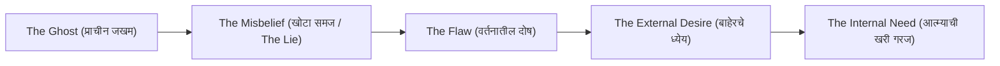

# MASTER RESEARCH: CHARACTER ARCHITECTURE, BACKSTORY INTEGRATION, AND FRANCHISE RESET ENGINE
*(A High-Level Strategic Blueprint for Universe B by Narrative Architecture Research)*

---

## EXECUTIVE SUMMARY & PURPOSE (उद्देश आणि सारांश)

दीर्घकाळ चालणाऱ्या (Long-Running) महाकाय फ्रँचायझींमध्ये (उदा. *Pokémon, Marvel, JoJo’s Bizarre Adventure, Lord of the Mysteries, Mistborn, Star Wars*) सर्वात मोठा धोका असतो:
1. **The Ash Ketchum Syndrome (पात्र-अडकलेपण):** जर वाचक फक्त एकाच पात्राशी जोडला गेला, तर ते पात्र बदलताच संपूर्ण फ्रँचायझी कोलमडते.
2. **Superficial Characters (उथळ पात्रे):** जर पात्रांना योग्य 'Ghost' (अंतर्गत जखम) आणि 'Misbelief' (खोटा समज) नसेल, तर ते केवळ लेखकाचे बाहुले वाटतात.
3. **The Power Scaling Trap (अमाप शक्तीचा स्फोट):** एकाच पात्राला ५०० चॅप्टर्स चालवल्यास शेवटी त्याला 'देव' बनवावे लागते, ज्यामुळे कथेतील सर्व थरार संपून जातो.

हे संशोधन स्पष्ट करते की:
* **पात्राची खरी ताकद कशात असते?** (Sanderson / McKee / Truby Model)
* **बॅकस्टोरी कथेमध्ये विष न कालवता नैसर्गिक कशी विणायची?**
* **जेव्हा टाइमलाइन किंवा मुख्य नायक बदलेल, तेव्हा वाचकांचा बॅकलॅश (Backlash) न होता ते उलट कसे उड्या मारतील?** (JoJo + LOTM + Cloud Atlas Framework)
* **कोणताही नवीन Writer Agent आला तरी या नियमांना धरूनच कसे लिहील?**

---

# PART 1: THE DEEP CHARACTER PSYCHOLOGY (पात्र निर्मितीचे मानसशास्त्र)

पात्र म्हणजे त्याची हेअरस्टाईल, त्याचा पोशाख किंवा त्याच्याकडे असणारी जादू नव्हे. पात्र म्हणजे **त्याच्या आत्म्यावर झालेली जखम आणि त्यातून तो जगाकडे कसा बघतो** ही दृष्टी!

### १. The Ghost (भूत / जुनी अदृश्य जखम)
* **व्याख्या:** पात्राच्या भूतकाळातील अशी एक वेदनादायी घटना, अपयश किंवा अपमान, ज्याने त्याचे व्यक्तिमत्त्व कायमचे जखमी केले आहे.
* **Neel चा Ghost:**
  * तो मुंबईच्या दादर स्टेशनच्या गर्दीत चिरडला गेलेला, ११ रुपयांसाठी उपाशी राहिलेला, आणि समाजाच्या लेखी "शून्य किंमत" असलेला सामान्य पोरगा आहे.
  * त्याच्या वडिलांनी किंवा कुटुंबाने पैशांच्या कमतरतेमुळे अनुभवलेला अपमान, आणि स्वतःला "मी कधीही काहीच मोठा बदल घडवू शकत नाही" ही वाटणारी असहाय्यता (Helplessness).
* **नियम:** बॅकस्टोरी ही कधीही ५ पॅराग्राफचे भाषण नसते. Ghost हा त्याच्या **प्रत्येक छोट्या निर्णयात** दिसला पाहिजे (उदा. चिखलात पडलेले १ तांब्याचे नाणे पाहून पोटात पडलेला खड्डा).

### २. The Misbelief (खोटा समज / The Lie)
* **व्याख्या:** त्या Ghost मुळे पात्राने जगाबद्दल किंवा स्वतःबद्दल एक विषारी नियम मनाशी पक्का केलेला असतो.
* **Neel चा Misbelief:**
  * *"या जगात फक्त तेच जगू शकतात ज्यांच्याकडे ताकद आणि वर्ग (Class/System) आहे; माझ्यासारख्या किड्याने फक्त डोके खाली घालून, मार खाऊन, जिवंत राहण्याचा प्रयत्न केला पाहिजे. नायक बनणे हा श्रीमंतांचा खेळ आहे."*
* **कथेचा संघर्ष:** कथेतील प्रसंग या समजावर सतत हातोडा मारतील, जोपर्यंत तो हे समजून घेणार नाही की: *"श्रीमंतांची व्यवस्था मोडण्यासाठी अन्यायाविरुद्ध उभे राहावेच लागते."*

### ३. The Flaw (वर्तनातील दोष)
* **व्याख्या:** Misbelief मुळे पात्राकडून घडणाऱ्या चुका.
* **Neel चा Flaw:**
  * अति-सावधगिरी (Over-cautiousness), स्वतःला कमी लेखणे (Imposter Syndrome), आणि सुरुवातीला मोठ्या उद्दिष्टांपासून पळ काढणे.
  * **ब्रँडन सँडरसनचा नियम:** पात्राचा दोष हा केवळ "तो लंगडा आहे" किंवा "तो गरीब आहे" हा नसतो; तो असा असला पाहिजे ज्यामुळे त्याच्या नात्यांमध्ये आणि निर्णयांमध्ये अडथळे निर्माण होतात!

### ४. External Desire (Want) vs Internal Need (Need)
* **The Want (त्याला काय हवे आहे?):** फक्त Central City च्या आत शिरायचे आहे, सुरक्षित राहायचे आहे, आणि जिवंत राहायचे आहे.
* **The Need (त्याच्या आत्म्याला कशाची गरज आहे?):** स्वतःच्या असहाय्यतेला फेकून देऊन, त्या अन्यायी जगाच्या व्यवस्थेला (Central City च्या भिंतीला) आव्हान देणारा आवाज बनायचे आहे.
* **Climax चा क्षण:** कथेच्या शेवटी त्याला आपल्या सुरक्षेचा त्याग करून इतरांसाठी (उदा. Sheru किंवा अनइंडेक्स्ड लोकांसाठी) लढण्याचा निर्णय घ्यावा लागतो.

---

# PART 2: HOW TO WEAVE BACKSTORY (बॅकस्टोरी कथेत कशी ओतायची?)

कोणत्याही नवशिक्या लेखकाची सर्वात मोठी चूक म्हणजे: **"Info-Dumping"** (पात्राचा भूतकाळ सलग ३ पाने समजावून सांगणे).

### The "Iceberg" Principle (हिमनगाचा नियम)
* ९०% बॅकस्टोरी पात्राच्या कृतीत लपलेली असावी, फक्त १०% पृष्ठभागावर दिसावी.
* **उदा. Scene 2 व Scene 4 मध्ये आपण काय केले?**
  * आपण सांगितले नाही की "नील हा मुंबईत खूप गरीब होता."
  * आपण फक्त दाखवले: *तो दादर-माटुंगा लोकल पास खिशातून काढतो, ११ रुपयांची किंमत आठवून हसतो, आणि कोरड्या भाकरीचा अर्धा तुकडा त्या भुकेल्या कुत्र्यापुढे टाकताना स्वतःच्या भुकेची जाणीव दाबून टाकतो.*
  * **वाचकाला लगेच समजते:** या मुलाने गरिबी आणि भूक स्वतः भोगली आहे! याला शब्दांची गरज नाही!

---

# PART 3: THE FRANCHISE RESET ENGINE (द जोजो आणि एलओटीएम फ्रेमवर्क)

भविष्यात जेव्हा **कालखंड (Era), टाइमलाइन किंवा मुख्य नायक बदलेल**, तेव्हा वाचकांना कसा धक्का बसू नये, उलट त्यांनी त्याचे स्वागत कसे करावे? यासाठी **४ सुवर्ण नियम** आहेत:

### १. The "Inherited Will" & Cosmic Lineage (जो-जो मॉडेल)
* *JoJo’s Bizarre Adventure* मध्ये जोनाथन जोएस्टार मरण पावतो, पण त्याचा 'गोल्डन स्पिरिट' पुढच्या पिढीत (जोसेफ, जोतारो) जातो.
* **Universe B मध्ये:**
  * एका कालखंडातून दुसऱ्या कालखंडात जाताना **"The Unindexed Flame"** (प्रतिग्रहाच्या गुलामगिरीला नकार देणारा आत्मा) पुढच्या नायकामध्ये संक्रमित होतो.
  * जुना नायक इतिहास बनतो, पण त्याची विचारधारा नवीन नायकाच्या युगात एक धर्म किंवा क्रांतिकारी तत्त्वज्ञान बनलेली असते.

### २. The "Relic / Artifact Bridge" (एलओटीएम - रोझेल डायरी मॉडेल)
* *Lord of the Mysteries* मध्ये जेव्हा नवीन MC (Klein) जुन्या पात्राची (Emperor Roselle) डायरी वाचतो, तेव्हा वाचकांना सर्वात जास्त रोमांच मिळतो.
* **आपल्या विश्वात:**
  * जेव्हा नवीन युगातील नवीन नायक एका प्राचीन मंदिरात किंवा गुप्त तळघरात जातो, तेव्हा त्याला भिंतीवर कोरलेले देवनागरी शब्द दिसतात.
  * त्याला एक प्राचीन, काच फुटलेली वस्तू सापडते ज्याच्यावर **'Redmi'** किंवा **'Dadar-Matunga'** असे पुसट चिन्ह असते. त्या युगातील लोक त्याला **"Grade-0 Divine Artifact"** मानत असतात!
  * **वाचकाची प्रतिक्रिया:** *"बाप रे! हा Neel चा फोन आहे! म्हणजे ३०० वर्षांपूर्वी Neel ने ही जागा उध्वस्त केली होती!"* 
  * वाचक नवीन पात्राच्या माध्यमातून जुन्या पात्राचे पाऊलखुणा शोधायला सुरुवात करतो!

### ३. Rebooting the Power Scale (शक्तीच्या समीकरणाचा रीसेट)
* एकाच पात्राची लेव्हल ९९ झाली की कथा कंटाळवाणी होते.
* नवीन कालखंड सुरू झाल्यावर नवीन नायक पुन्हा **Level 1** वरून सुरू होतो.
* परंतु, आता जगाचे नियम आधीपेक्षा अधिक क्लिष्ट असतात, कारण जुन्या नायकाने जगाची व्यवस्था बदललेली असते. त्यामुळे नवीन नायकाला नव्या पद्धतीने संघर्ष करावा लागतो.

### ४. The Eternal World Anchor (जग हेच मुख्य पात्र आहे)
* Central City, Singularity Sieve, आणि The 72,000 Nadis — हे कधीही बदलत नाहीत.
* वाचक त्या जगाच्या कायद्यांशी इतके एकरूप झालेले असतात की, कोणत्याही नवीन पात्राला त्या कायद्यांशी झुंजताना पाहणे ही वाचकांसाठी पर्वणी ठरते.

---

# PART 4: THE WRITER AGENT EXECUTION FORMULA (भविष्यातील लेखकासाठी ५-सूत्री चेकलिस्ट)

जेव्हा कोणताही AI एजंट किंवा लेखक नवीन पात्राचा प्रवेश लिहील, तेव्हा त्याने खालील प्रश्नांची उत्तरे कथेच्या आत विणलीच पाहिजेत:

| क्रम | घटक (Element) | लेखक तपासणी प्रश्न (Writer Verification) |
| :--- | :--- | :--- |
| **१** | **The Wound (जखम)** | या पात्राने भूतकाळात काय गमावले आहे? त्याचा परिणाम आत्ताच्या दृश्यात कसा दिसतोय? |
| **२** | **The Lie (खोटा समज)** | हे पात्र स्वतःबद्दल कोणता चुकीचा समज बाळगून आहे? |
| **३** | **The World Tie (जगाशी नातं)** | हे पात्र Central City च्या कोणत्या वर्गातून (Socio-economic tier) आले आहे? ते ७२,००० नाड्यांच्या कोणत्या टप्प्यावर अडकले आहे? |
| **४** | **The Legacy Bridge** | हे पात्र जुन्या नायकाच्या (उदा. Neel) इतिहासाला कसे पाहते? (देव मानून? शत्रू मानून? की विसरलेली दंतकथा मानून?) |
| **५** | **The Small Choice** | या दृश्यात हे पात्र आपल्या स्वार्थाच्या पलीकडे जाऊन कोणती छोटी, मानवी कृती करते? |

---

## निष्कर्ष (CONCLUSION)

Universe B हे एका माणसाचे वैयक्तिक साहस नाही; **हे मानवी आत्म्याने वैश्विक अन्यायाविरुद्ध पुकारलेले युगानुयुगांचे युद्ध आहे.**

Neel हा त्या महाकाय युद्धाची पहिली ठिणगी आहे. वाचकांना आधी या ठिणगीवर प्रेम करायला शिकवायचे, आणि नंतर त्या ठिणगीतून भडकणाऱ्या महावन्हीमध्ये (Universe B मध्ये) संपूर्ण जगाला सामावून घ्यायचे आहे!
