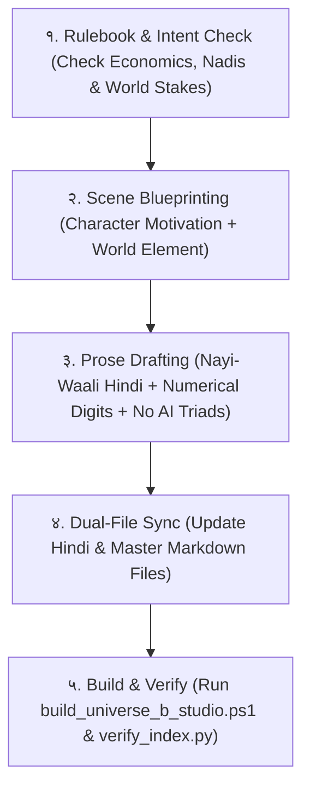

# UNIVERSE B: WORLD IMMERSION & CANONICAL WRITING SYSTEM
*(The Immutable Writer Bible, World-Bonding Architecture, and Multi-Era Agent Continuity Protocol)*

---

## 0. PREAMBLE & CORE INTENT (प्रस्तावना आणि मुख्य हेतू)

**हा दस्तऐवज (Document) का तयार करण्यात आला आहे?**
जेव्हा एखादा दीर्घकाळ चालणारा वेब नोव्हेल प्रोजेक्ट लिहिला जातो, तेव्हा:
1. **Writer Agent / AI मॉडेल बदलले तरी:** कथेचा टोन, भाषेची ठेवण (Voice & Cadence), पात्रांची स्वाभाविकता, आणि सीन रचनेचे नियम जराही बदलता कामा नयेत.
2. **The "Ash Ketchum Problem" रोखण्यासाठी:** जर वाचकांचा भावनिक बंध फक्त मुख्य पात्राशी (Neel) असेल, तर भविष्यात जेव्हा टाइमलाइन बदलेल किंवा नवीन नायक येईल, तेव्हा वाचक कथा नाकारतील (जसा पोकेमॉनमध्ये ॲश बदलल्यावर बॅकलॅश आला).
3. **The Solution (MCU + LOTM + Cloud Atlas Model):** वाचकांना **या विश्वाच्या (Universe B) प्रेमात पाडणे**. वाचकांना Central City, तिची भिंत, तिथली दारिद्र्य आणि श्रीमंतीची दरी, ७२,००० नाड्यांचे कठोर नियम, तांब्याचे 'पण' (Panas), आणि आकाशातल्या 'चाळणी'च्या (Singularity Sieve) रहस्यात इतके गुंतवून ठेवणे की मुख्य पात्र बदलले तरी जग जिवंत राहील आणि आदराचे स्थान बनेल.

---

## PART 1: WORLD IMMERSION ARCHITECTURE (जगाशी वाचक कसा जोडला जाईल?)

एका साध्या कथेत आणि एका 'पंथ' (Cult Following) बनणाऱ्या महाकाव्यात हाच फरक असतो: **जगात जीवन आणि रहस्य असले पाहिजे.**

### Pillar 1: The Wish-Fulfillment & Hard Living System (वाचकाला स्वतःची कल्पना करता आली पाहिजे)
* **Harry Potter** मध्ये लोक स्वतःला हॉगवॉर्ट्सच्या घरांमध्ये कल्पायचे.
* **Lord of the Mysteries (LOTM)** मध्ये लोक २२ पाथवेजपैकी आपली पाथवे निवडायचे.
* **Universe B चे नियम:**
  * **७२,००० नाड्या (The Nadis):** प्रत्येक जीवाच्या शरीरात ७२,००० सूक्ष्म ऊर्जा मार्ग आहेत. 
  * जन्मजात ९९.९% लोकांच्या नाड्या मळ, अज्ञान आणि कर्माने "गोठलेल्या / गाठ बांधलेल्या" (Knotted/Blocked) असतात.
  * *इडा (चंद्र - थंडावा, ज्ञान, विश्लेषण)*, *पिंगला (सूर्य - उष्णता, शक्ती, आक्रमकता)* आणि *सुषुम्णा (शून्य - वैश्विक चैतन्य)*.
  * ऊर्जा मोफत मिळत नाही: **'प्रतिग्रह' (Pratigraha - The Law of Cosmic Debt)**. जर तू निसर्गाकडून किंवा विश्वाकडून एक थेंब प्राण घेतलास, तर विश्वाला काहीतरी परत द्यावं लागतं.
  * **वाचकाचा विचार:** *"जर मी या जगात असतो, तर माझी कोणती नाडी उघडी असती? मी कोणत्या चक्रावर अडकलो असतो?"*

### Pillar 2: The Living Texture & Grounded Reality (कथेचा जिवंत पोत)
* जग काल्पनिक असले तरी तिथली भूक, चिखल आणि पैशांची चणचण **१००% वास्तववादी** वाटली पाहिजे.
* **आर्थिक नियम (Hard Economics):**
  * कोणतीही काल्पनिक "लाखो सोन्याची नाणी" सुरुवातीला फेकली जाणार नाहीत.
  * **१ तांब्याचा पण (Copper Pana)** = एका भुकेल्या मजुराची अर्ध्या दिवसाची कोरडी भाकर.
  * **३ पण** = दिवसभराची हाडं मोडणारी मजुरी (गाडी चिखलातून उपसणे).
  * **५ पण** = Central City च्या महाकाय दारातून आत पाय ठेवण्याचा जकात (Gate Toll).
  * **२ पण ची कमतरता** = एका माणसासाठी गुलामगिरी किंवा मृत्यू!
  * **अन्नाची किंमत:** कोरडा, घशाला ओरखडे पाडणारा बाजरीचा तुकडा मजुरासाठी अमृतासारखा असतो.
* **संवेदना (Sensory Details):**
  * चिखलाचा दुर्गंध, वाफेचा गरम फुत्कार, ओल्या पेंढ्याचा वास, तांब्याच्या नाण्यांचा खणखणाट, चाबकाचा हवेतला थरकाप.

### Pillar 3: Living Entities (ठिकाणे आणि संस्था ही स्वतः पात्रे आहेत)
* **Central City ची १०० फूट काळी भिंत:** 
  * ही फक्त दगडी भिंत नाही; हा अभिजात (Classified) आणि बेवारस (Unindexed) लोकांच्या मधील क्रूर पडदा आहे.
  * तिच्या प्राचीरावर उभे असलेले पहारेकरी खाली चिखलात रेंगाळणाऱ्या माणसांना किड्यांसारखे पाहतात.
* **The Dawn Bell (पहाटेची महाकाय घंटा):**
  * तिचा नाद जेव्हा हवेत घुमतो, तेव्हा हजारो मजुरांच्या पोटात भीतीचा गोळा येतो, कारण तो नाद म्हणजे: *"दरवाजा उघडणार, आणि ज्यांच्याकडे ५ पण नाहीत, त्यांना चाबकाने हाकलले जाणार."*
* **The Sieve (आकाशातली चाळणी):**
  * वरचा मटमैला, धूसर आकाश ज्याच्यावर एक अदृश्य, जाळ्यासारखी रचना आहे. तिथून तारा किंवा चंद्र दिसत नाही, फक्त गूढ कंपन जाणवते.

### Pillar 4: Parallel Lives (इतर पात्रांना स्वतःचे स्वतंत्र आयुष्य आहे)
* कथेतील कोणताही दुय्यम व्यक्ती (Wagon Master, पहारेकरी, चिखलात पडलेला भिकारी, किंवा भुकेला पिल्लू) फक्त मुख्य पात्राला मदत करण्यासाठी जन्माला आलेला नाही.
* प्रत्येकाला स्वतःची भूक, स्वतःची बायको-मुलं, किंवा स्वतःची लाचखोरी सांभाळायची आहे.
* जेव्हा मुख्य पात्र त्यांच्याशी संवाद साधतो, तेव्हा जगाचे वास्तव उघडे पडते.

### Pillar 5: The Eternal Cosmic Mystery (LOTM & Cloud Atlas Anchor)
* वाचकाला खिळवून ठेवणारे महा-गूढ:
  1. **Singularity Sieve ने पृथ्वीच्या लोकांनाच का खेचले?**
  2. **Neel च्या आधी कोणी प्रवासी आले होते का?** (LOTM मधील Roselle च्या डायरीप्रमाणे जुने अवशेष, भिंतींवर जुन्या लिपीत कोरलेले इशारे).
  3. **७२,००० वी नाडी उघडल्यावर माणूस काय बनतो?**
  4. **The Five Shards (पाच तुकडे):** हे जग तुटलेलं का आहे?
* हे गूढ इतके विशाल आहे की, युगे बदलली किंवा मुख्य पात्र बदलले, तरी वाचक पुढील रहस्य शोधण्यासाठी प्रत्येक ओळ वाचत राहील.

---

## PART 2: THE "ANTI-BACKLASH" PROTAGONIST TRANSITION SYSTEM
*(भविष्यात मुख्य पात्र बदलताना किंवा टाइमलाइन शिफ्ट करताना पाळावयाचे नियम)*

1. **The Pioneer's Scar (नीलची जगावर कायमची छाप):**
   * Neel हा फक्त जिंकणारा हिरो नाही; तो या जगाच्या व्यवस्थेला (Central City च्या अन्यायाला) असा धक्का देईल की जग कायमचे बदलेल.
   * भविष्यातील पिढ्यांसाठी Neel हा एक दंतकथा (Myth / Pioneer) असेल.
2. **Karmic Resonance (कौटुंबिक आणि आत्म्याचा धागा):**
   * Neel ने आज चिखलात एका लहान भुकेल्या पिल्लाला (Sheru) दिलेली अर्धी कोरडी भाकर... शेकडो वर्षांनंतरच्या टाइमलाइनमध्ये एका दैवी, अभेद्य सिंहाच्या रूपाने त्या वारशाचे रक्षण करेल.
   * कर्माची फळे काळाच्या पलीकडे प्रवास करतील.
3. **Artifact Inheritance:**
   * Neel चा तो जुना, फुटलेला Redmi फोन किंवा त्याचे दादर-माटुंगा लोकलचे तिकीट हे भविष्यातील युगात एका मंदिरात किंवा गुप्त संग्रहालयात "Grade-0 Unindexed Relic" म्हणून पूजले जाईल. नवीन पात्राला जेव्हा हे दिसेल, तेव्हा वाचकांच्या डोळ्यात पाणी आणि अंगावर काटा येईल!

---

## PART 3: CANONICAL WRITING STYLE & PROSE GUIDELINES
*(शैली, भाषा आणि वाक्यरचना - कोणत्याही एजंटसाठी अनिवार्य नियम)*

### १. The Voice (आवाज आणि सूर)
* **Tone:** *दिव्य प्रकाश दुबे (Nayi-Waali Hindi) + Crunchyroll/Muse India Modern Anime Dub Cadence.*
* भाषा जड, संस्कृतप्रचुर किंवा बोजड असू नये; तसेच ती उथळ किंवा इंग्रजाळलेली असू नये.
* **नीलचा आवाज:** अस्सल मुंबईकर मुलगा. दादर, लोकल ट्रेन, ११ रुपयांची किंमत जाणणारा, व्यावहारिक (Street-smart), कष्टाळू, आणि संकटातही मनात कोरडा विनोद (Dry Wit) जपणारा.
* **जगाचा आवाज:** प्राचीन, क्रूर, वैदिक-सायबर फॅन्टसी, आणि नियमांवर चालणारे.

### २. Absolute Ban on "AI Writing Patterns" (या गोष्टींवर १००% बंदी)
कोणत्याही लेखकाने खालील कृत्रिम (Robotic AI) साचे लिहायचे नाहीत:
* ❌ **Staccato Triads (एकाच शब्दाची तीन तोडकी वाक्ये):**
  * बंदी: *"धीमी। गहरी। पतली।"* किंवा *"न कोई लहर। न कोई कंपन।"*
  * योग्य: *"हवा में न कोई लहर थी, न हलचल; बस एक भारी, जमा हुआ सन्नाटा पसरा था।"*
* ❌ **Duplicate Intros/Outros:** प्रोलॉग जिथे संपतो, तिथूनच चॅप्टर १ सुरू झाला पाहिजे; एकाच प्रसंगाची पुनरावृत्ती होता कामा नये.
* ❌ **Unearned Melodrama:** छोट्या गोष्टींवर अति-भावनिक भाषणे बंदी. भावना कृतीतून (Actions & Choices) दिसल्या पाहिजेत.

### ३. Numerical Digits Rule (आकडे नेहमी अंकांमध्येच)
* ❌ शब्द बंदी: *"अट्ठावन", "तीन", "पाच", "सत्त्याहत्तर हजार", "अकरा"*
* ✅ अनिवार्य अंक: `58`, `3`, `5`, `72,000`, `11`, `0.2`, `100`
* कारण: आधुनिक वेब नोव्हेल वाचकांना आकडे आकड्यांत वाचताना अचूक गणित आणि स्टेक्स (Stakes) लगेच समजतात.

### ४. Dual-Language File Synchronization Rule
प्रकल्पातील प्रत्येक प्रकरण दोन फाइल्समध्ये एकाच वेळी अपडेट झाले पाहिजे:
1. `Story/[File_Name]_Hindi.md` (मूळ आधुनिक हिंदी आवृत्ती)
2. `Story/[File_Name].md` (ग्लोबल/इंग्रजी किंवा मास्टर ट्रॅक)
दोन्ही फाइल्समधील सीन्स, अर्थ आणि आकडे तंतोतंत जुळले पाहिजेत.

---

## PART 4: WRITER AGENT EXECUTION PROTOCOL (कार्यपद्धती)

कोणत्याही नवीन Writer Agent ने नवीन सीन किंवा चॅप्टर लिहिताना या **५ पायऱ्यांचा (Steps)** वापर करणे बंधनकारक आहे:

1. **Step 1: Intent & Stakes Check:**
   * या सीनमध्ये जगाचा कोणता पैलू समोर येतोय? (अर्थकारण? नाडी? भेदभावाची भिंत? भुकेचे वास्तव?)
2. **Step 2: Character Choice:**
   * नील या सीनमध्ये केवळ पाहत नाहीये, तो काय निर्णय घेतोय? (उदा. स्वतः उपाशी राहून कुत्र्याला भाकर देणे).
3. **Step 3: Prose Drafting:**
   * 'नयी वाली हिंदी', जिवंत संवाद, मुंबईकर विनोद, अंकांचा वापर, शून्य AI क्लिषे.
4. **Step 4: Dual Sync:**
   * `Story/` फोल्डरमधील दोन्ही फाइल्स एकाच वेळी अपडेट करणे.
5. **Step 5: Studio Build & Index Verification:**
   * `powershell -File ".\UNIVERSE B\scripts\build_universe_b_studio.ps1"`
   * `python ".\UNIVERSE B\scripts\verify_index.py"` (सर्व २८/२८ assertions पास झाले पाहिजेत).

---

**या दस्तऐवजातील सर्व नियम अपरिवर्तनीय (Immutable) असून ते Universe B च्या संपूर्ण प्रवासात प्रमाण मानले जातील.**
